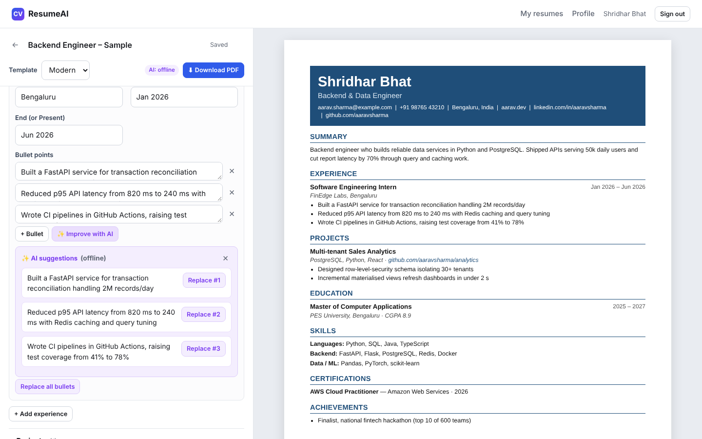

# ResumeAI: AI-Powered Resume Builder

A full-stack resume builder with user accounts, a profile that pre-fills new resumes, three templates with a live preview, AI writing suggestions, job-description matching and server-side PDF export.

**Stack:** Python 3.10+ · Flask · SQLite · ReportLab (PDF) · vanilla JS (no build step) · Gemini / OpenAI / Anthropic over REST



## Features

| Area | What it does |
|---|---|
| **Auth** | Register, sign in, sign out, change password, delete account (deleting the account also deletes its resumes). Passwords are hashed with scrypt through Werkzeug. |
| **Profile** | Name, headline, contact links, target role and a default summary. Each new resume is pre-filled from the profile. |
| **Resumes** | Create from your profile or from sample content, then rename, duplicate or delete. Sections: personal details, summary, experience, projects, education, skills, certifications and achievements. You can reorder entries, and changes autosave. |
| **Templates** | Modern, Classic and Minimal. You can switch at any time and the live preview updates on every save. |
| **AI suggestions** | ✨ Generate a summary · ✨ Improve bullet points (one by one or all at once) · ✨ Suggest skills for your target role. You apply each suggestion with one click. |
| **Job match** | Paste a job description to get a keyword-match score, lists of matched and missing keywords, and tips for tailoring the resume. |
| **PDF export** | Real, selectable text that ATS software can parse. Links are clickable. The PDF uses A4 and the file is named after you. |

## Quick start

```bash
cd resume-builder
python -m venv .venv
# Windows: .venv\Scripts\activate      macOS/Linux: source .venv/bin/activate
pip install -r requirements.txt
cp .env.example .env          # Windows: copy .env.example .env
# edit .env → set SECRET_KEY and (optionally) an AI key
python run.py                 # → http://127.0.0.1:5000
```

Run the tests with `pytest -q`. There are 25 tests covering auth, CSRF, the rate limiter, the ownership checks that keep each user's resumes private, input sanitising, PDF output for every template, and the AI fallbacks.

### AI setup

Put **one** key in `.env`. The app uses the provider named in `AI_PROVIDER`. If that is empty, it uses the first key it finds.

| Provider | Key variable | Default model |
|---|---|---|
| Google Gemini (has a free tier) | `GEMINI_API_KEY` | `gemini-3.5-flash-lite` |
| OpenAI | `OPENAI_API_KEY` | `gpt-5-mini` |
| Anthropic | `ANTHROPIC_API_KEY` | `claude-haiku-5-5` |

With **no key**, the app runs in `offline` mode. A built-in rule-based engine replaces weak openers such as "worked on" or "responsible for" with stronger verbs, adds `[X%]` placeholders where a bullet has no metric, suggests skills for each role, and fills in summary templates. If a remote provider fails or times out, the app also falls back to this engine and shows a notice, so a demo keeps working without a connection. Model names change often. If a call fails with an HTTP 404, update `*_MODEL` in `.env`.

## Project structure

```
resume-builder/
├── run.py                     # dev entry point
├── app/
│   ├── __init__.py            # app factory: wires blueprints, CSRF, security headers
│   ├── config.py              # env-driven settings
│   ├── db.py                  # SQLite schema + connection per request
│   ├── security.py            # CSRF, login_required, rate limiter, CSP headers
│   ├── auth.py                # register / login / logout / password / delete account
│   ├── profile.py             # user profile
│   ├── resumes.py             # dashboard, editor, preview, PDF, JSON API
│   ├── resume_model.py        # resume schema, normalize(), templates registry, sample data
│   ├── ai.py                  # prompts, 3 REST providers, offline engine, /api/ai/suggest
│   ├── pdf_export.py          # ReportLab renderers (one per template)
│   ├── templates/             # Jinja pages + resume_templates/{modern,classic,minimal}.html
│   └── static/                # css/app.css, js/editor.js, js/app.js
├── tests/test_app.py
└── docs/                      # screenshots + sample PDFs
```

### Data model

```
users(id, email UNIQUE, name, password_hash, created_at)
profiles(user_id PK→users, full_name, headline, email, phone, location, website, linkedin, github, summary, target_role)
resumes(id, user_id→users, title, template, data JSON, created_at, updated_at)   -- ON DELETE CASCADE
```

Each resume's content is stored as one JSON document. Data sent by the client always passes through `resume_model.normalize()` before it is stored. That function whitelists the allowed keys, limits string lengths and list sizes, and drops empty entries.

### HTTP API (used by the editor)

| Method | Path | Body / notes |
|---|---|---|
| `GET` | `/api/resumes/<id>` | → `{id, title, template, data}` |
| `PUT` | `/api/resumes/<id>` | `{title?, template?, data?}`, requires the `X-CSRF-Token` header |
| `POST` | `/api/ai/suggest` | `{kind: summary\|bullets\|skills\|keywords, context: {resume, item?, target_role?, job_description?}}` → `{suggestions[], provider, notice?, report?}` |
| `GET` | `/resumes/<id>/pdf` | PDF download (`?inline=1` to view it in the browser) |
| `GET` | `/resumes/<id>/preview?template=` | HTML preview |

## Security

- **Passwords:** salted scrypt hashes. The minimum is 8 characters with at least one letter and one number. Login takes the same time whether or not the email exists, so response timing doesn't reveal which emails have accounts.
- **Sessions:** cookies are `HttpOnly` and `SameSite=Lax`, and `Secure` when `SESSION_COOKIE_SECURE=true`. The session is regenerated at login to prevent session fixation.
- **CSRF:** every POST/PUT needs a token tied to the session (a form field, or the `X-CSRF-Token` header for fetch requests).
- **Brute force:** after 5 failed logins for the same IP and email, that pair is locked out for 15 minutes. AI calls are limited per user per hour.
- **Authorisation:** every resume query filters on `user_id`. Requests for another user's resume get a 404, so the app doesn't reveal that the resume exists.
- **XSS:** Jinja escapes output automatically. The editor escapes every value it inserts. The Content Security Policy only allows `script-src 'self'`, so the pages contain no inline scripts.
- **Open redirect:** `?next=` only accepts relative paths on the same site.
- **Other limits:** requests are capped at 512 KB, and the PDF renderer escapes all text before building its markup.

## Deploying

```bash
# Linux
gunicorn -w 2 -b 0.0.0.0:8000 "app:create_app()"
# Windows
waitress-serve --port=8000 --call app:create_app
```

Set a fixed `SECRET_KEY`, serve the app over HTTPS, and set `SESSION_COOKIE_SECURE=true`. The rate limiter keeps its counts in memory, so if you run more than one server process, move it to Redis.

## Possible extensions

- OAuth sign-in (Google or GitHub)
- Upload an existing PDF resume and parse it into the editor
- Cover-letter generation from the resume plus a job description
- More templates (each one needs an HTML file in `templates/resume_templates/` and a renderer in `pdf_export.py`)
- Embed a Unicode TTF font such as Noto Sans for non-Latin scripts. The built-in PDF fonts only cover Western European characters.
