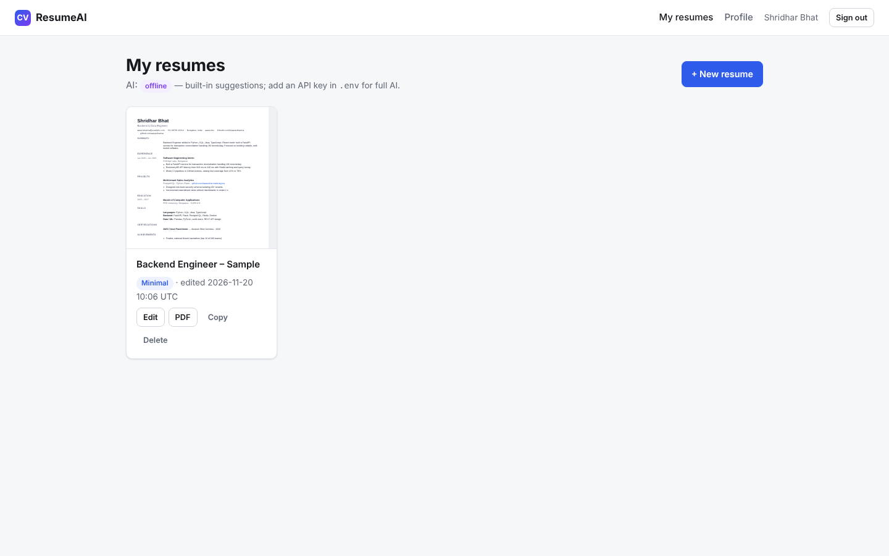
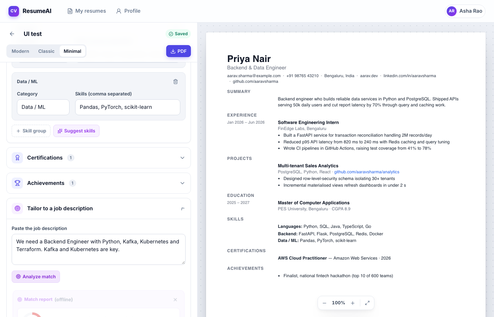

<div align="center">

# ResumeAI

**Write a better resume, tailor it to any job, and export an ATS-friendly PDF, with AI help that also works offline.**


[](https://github.com/shridhar618/resume-builder/stargazers)

[Features](#features) · [Screenshots](#screenshots) · [Quick start](#quick-start) · [AI setup](#ai-setup) · [Security](#security) · [Contributing](#contributing)


</div>

ResumeAI is a full-stack resume builder with user accounts, a profile that pre-fills new resumes, three templates with a live preview, AI writing suggestions, job-description matching and server-side PDF export.

**Stack:** Next.js 16 (App Router) · React 19 · TypeScript · SQLite (better-sqlite3) · @react-pdf/renderer · Vitest · Gemini / OpenAI / Anthropic over REST

### Why it's different

- **Works without an API key.** A built-in rule-based engine rewrites weak bullets, suggests skills and drafts summaries, so the app is fully usable offline.
- **Real PDFs, not screenshots.** The exported text is selectable and parseable by applicant tracking systems (ATS), and links stay clickable.
- **Bring your own model.** Switch between Gemini, OpenAI and Anthropic with one environment variable.
- **Security built in.** It uses scrypt password hashing, CSRF tokens, a nonce-based CSP, rate limiting and per-user ownership checks, and tests cover them.

## Features

| Area | What it does |
|---|---|
| **Auth** | Register, sign in, sign out, change password, delete account (deleting the account also deletes its resumes). Passwords are hashed with scrypt. |
| **Profile** | Name, headline, contact links, target role and a default summary. Each new resume is pre-filled from the profile. |
| **Resumes** | Create from your profile or from sample content, then rename, duplicate or delete. Sections: personal details, summary, experience, projects, education, skills, certifications and achievements. You can reorder entries, and changes autosave. |
| **Templates** | Modern, Classic and Minimal. You can switch at any time, and the preview updates as you type. |
| **AI suggestions** | ✨ Generate a summary · ✨ Improve bullet points (one by one or all at once) · ✨ Suggest skills for your target role. You apply each suggestion with one click. |
| **Job match** | Paste a job description to get a keyword-match score, lists of matched and missing keywords, and tips for tailoring the resume. |
| **PDF export** | Real, selectable text that ATS software can parse. Links are clickable. The PDF uses A4 and the file is named after you. |

## Screenshots

| Dashboard | Job match |
|---|---|
|  |  |

Sample exports: [Modern](docs/sample-modern.pdf) · [Classic](docs/sample-classic.pdf) · [Minimal](docs/sample-minimal.pdf)

## Quick start

Requires **Node.js 20.9 or newer**.

```bash
cd resume-builder
npm install
cp .env.example .env          # Windows: copy .env.example .env
# edit .env → (optionally) add an AI key
npm run dev                   # → http://localhost:3000
```

For a production build, run `npm run build && npm start`.

Run the tests with `npm test`, and the type checker with `npm run typecheck`. The test suite covers password hashing, sessions, the rate limiter, the ownership checks that keep each user's resumes private, input sanitising, open-redirect protection, PDF output for every template, and the AI fallbacks.

### AI setup

Put **one** key in `.env`. The app uses the provider named in `AI_PROVIDER`. If that is empty, it uses the first key it finds.

| Provider | Key variable | Default model |
|---|---|---|
| Google Gemini (has a free tier) | `GEMINI_API_KEY` | `gemini-3.5-flash-lite` |
| OpenAI | `OPENAI_API_KEY` | `gpt-5-mini` |
| Anthropic | `ANTHROPIC_API_KEY` | `claude-haiku-5-5` |

With **no key**, the app runs in `offline` mode. A built-in rule-based engine replaces weak openers such as "worked on" or "responsible for" with stronger verbs, adds `[X%]` placeholders where a bullet has no metric, suggests skills for each role, and fills in summary templates. If a remote provider fails or times out, the app also falls back to this engine and shows a notice, so a demo keeps working without a connection. Model names change often. If a call fails with an HTTP 404, update `*_MODEL` in `.env`.

## Project structure

```
resume-builder/
├── src/
│   ├── proxy.ts                    # per-request nonce Content Security Policy
│   ├── app/
│   │   ├── layout.tsx              # top bar, flash messages
│   │   ├── actions.ts              # server actions: auth, profile, create/duplicate/delete resume
│   │   ├── page.tsx                # landing
│   │   ├── login/ register/        # auth pages (useActionState forms)
│   │   ├── dashboard/ profile/
│   │   ├── resumes/[id]/edit/      # editor page
│   │   ├── resumes/[id]/pdf/       # PDF download (route handler)
│   │   └── api/                    # JSON API used by the editor
│   ├── components/
│   │   ├── Editor.tsx              # client editor: autosave, live preview, AI panels
│   │   ├── ResumeView.tsx          # HTML rendering of the three templates
│   │   └── client.tsx              # small client pieces (dialogs, confirm forms, flashes)
│   └── lib/
│       ├── db.ts                   # SQLite schema + connection
│       ├── session.ts              # DB-backed sessions, login/logout, safe redirects
│       ├── password.ts             # scrypt hashing
│       ├── rateLimit.ts            # sliding-window limiter
│       ├── resumeModel.ts          # resume schema, normalize(), templates, sample data
│       ├── resumes.ts              # ownership-checked resume queries
│       ├── ai.ts                   # prompts, 3 REST providers, offline engine
│       ├── pdf.tsx                 # @react-pdf/renderer templates
│       └── flash.ts / api.ts / config.ts
├── tests/lib.test.ts
└── docs/                           # screenshots + sample PDFs
```

### Data model

```
users(id, email UNIQUE, name, password_hash, created_at)
profiles(user_id PK→users, full_name, headline, email, phone, location, website, linkedin, github, summary, target_role)
resumes(id, user_id→users, title, template, data JSON, created_at, updated_at)
sessions(token_hash PK, user_id→users, csrf, expires_at)        -- all ON DELETE CASCADE
```

Each resume's content is stored as one JSON document. Data sent by the client always passes through `normalize()` in `src/lib/resumeModel.ts` before it is stored. That function whitelists the allowed keys, limits string lengths and list sizes, and drops empty entries.

The schema and password-hash format (`scrypt:32768:8:1$salt$hash`) are the same as in the original Flask version, so an existing `instance/resume_builder.db` keeps working, including its accounts.

### HTTP API (used by the editor)

| Method | Path | Body / notes |
|---|---|---|
| `GET` | `/api/resumes/<id>` | → `{id, title, template, data, updated_at}` |
| `PUT` | `/api/resumes/<id>` | `{title?, template?, data?}`, requires the `X-CSRF-Token` header |
| `POST` | `/api/ai/suggest` | `{kind: summary\|bullets\|skills\|keywords, context: {resume, item?, target_role?, job_description?}}` → `{suggestions[], provider, notice?, report?}` |
| `GET` | `/api/ai/status` | → `{provider}` |
| `GET` | `/resumes/<id>/pdf` | PDF download (`?inline=1` to view it in the browser) |

Forms (sign in, profile, create/duplicate/delete) use Next.js server actions rather than HTTP endpoints. They also work with JavaScript disabled.

## Security

- **Passwords:** salted scrypt hashes. The minimum is 8 characters with at least one letter and one number. Login runs a hash comparison even when the email doesn't exist, so response timing doesn't reveal which emails have accounts.
- **Sessions:** a random token in an `HttpOnly`, `SameSite=Lax` cookie (`Secure` when `SESSION_COOKIE_SECURE=true`). The database stores only a SHA-256 of the token, and a new session is created on every login to prevent session fixation.
- **CSRF:** server actions are protected by Next.js's Origin check. The JSON API requires the per-session token in an `X-CSRF-Token` header.
- **Brute force:** after 5 failed logins for the same IP and email, that pair is locked out for 15 minutes. AI calls are limited per user per hour.
- **Authorisation:** every resume query filters on `user_id`. Requests for another user's resume get a 404, so the app doesn't reveal that the resume exists.
- **XSS:** React escapes all output. A per-request nonce CSP (`script-src 'self' 'nonce-…' 'strict-dynamic'`) blocks any other inline script.
- **Open redirect:** `?next=` only accepts relative paths on the same site.
- **Other limits:** request bodies are capped at 512 KB. PDF text is drawn as text, never parsed as markup.

## Deploying

```bash
npm ci
npm run build
PORT=8000 npm start
```

Serve the app over HTTPS and set `SESSION_COOKIE_SECURE=true`. SQLite needs a persistent disk, so run the app on a VM, a container with a volume, or a platform such as Railway or Fly.io. Serverless hosts such as Vercel need the database moved to a hosted one (Turso/libSQL or Postgres) first. The rate limiter keeps its counts in memory, so if you run more than one server process, move it to Redis.

## Possible extensions

- OAuth sign-in (Google or GitHub)
- Upload an existing PDF resume and parse it into the editor
- Cover-letter generation from the resume plus a job description
- More templates (each one needs styles in `globals.css` under `.rv-<name>` and a theme in `src/lib/pdf.tsx`)
- Register a Unicode TTF font such as Noto Sans for non-Latin scripts. The built-in PDF fonts only cover Western European characters.

## Contributing

Contributions are welcome. Any of the extensions above would make a good first pull request.

1. Fork the repo and create a branch: `git checkout -b feature/my-change`
2. Make your change, then run `npm test` and `npm run typecheck`
3. Open a pull request that describes what you changed and why

If you find a bug or have an idea, please [open an issue](https://github.com/shridhar618/resume-builder/issues).

---

<div align="center">

If ResumeAI helped you land an interview, please consider giving it a ⭐. It helps other people find the project.

</div>
